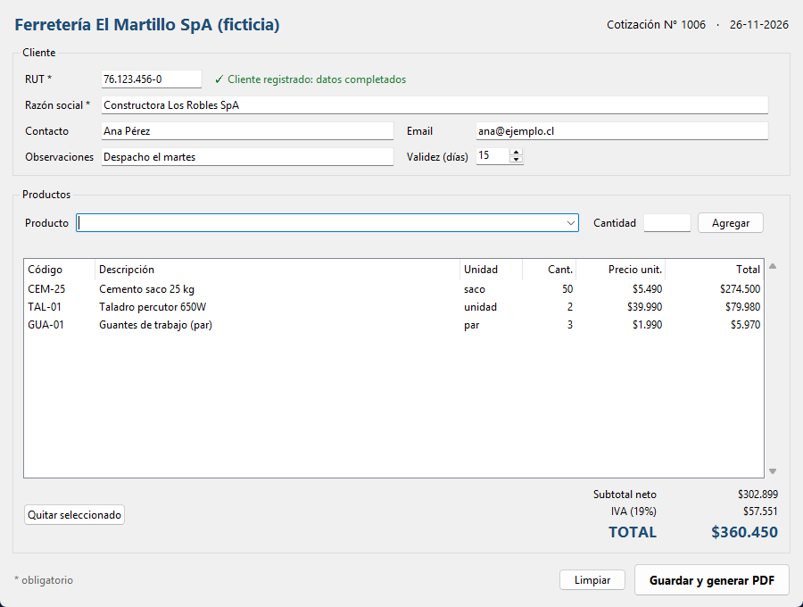
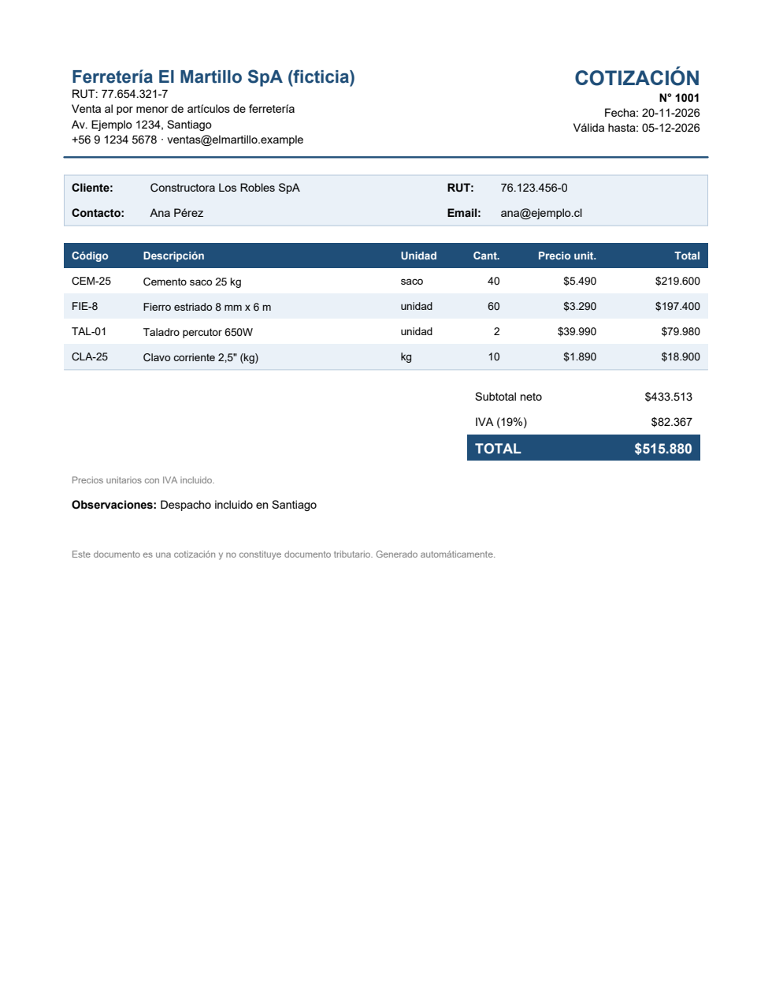
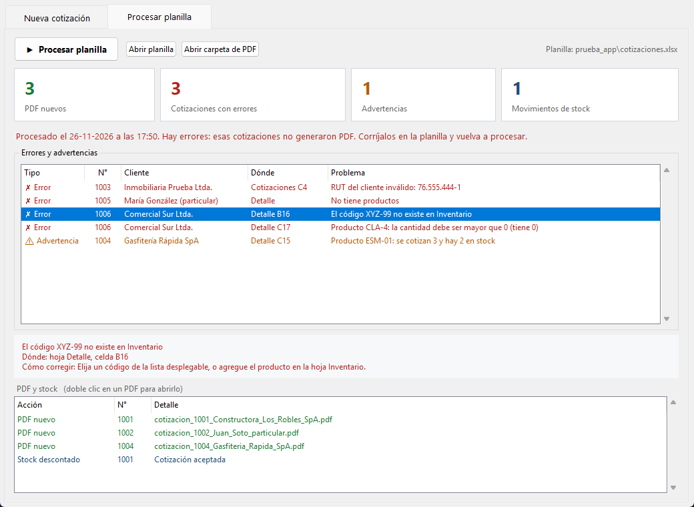
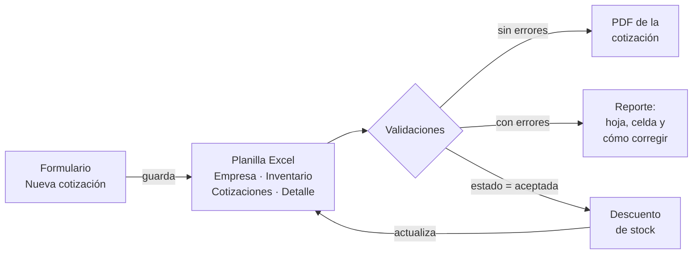

<div align="center">

# README principal

**Herramientas simples para que las pequeñas empresas chilenas dejen de escribir los mismos datos dos o tres veces.**


</div>

---

## La idea

Muchas pymes trabajan con **Excel, la facturación del SII y WhatsApp por separado**: copian el mismo cliente, el mismo precio y el mismo producto de un lado a otro. Eso cuesta horas cada semana y provoca errores.

Este repositorio reúne demos de **"pegamento"**: programas pequeños que conectan lo que la empresa **ya usa**, sin obligarla a cambiar de sistema ni a pagar un software grande.

| # | Demo | Qué resuelve | Estado |
|:-:|---|---|:-:|
| 1 | [**Generador de cotizaciones**](demo1-generador-documentos/) | De una planilla Excel a un PDF profesional, con inventario y stock | Funcional |
| 2 | Conector ventas ↔ inventario | No digitar dos veces una venta | Planificado |
| 3 | Cobranza automática | Recordatorios según vencimiento y cruce con la cartola del banco | Planificado |

---

## Demo 1 · Generador de cotizaciones

> El vendedor solo escribe **quién es el cliente** y **qué productos quiere (código + cantidad)**. Los precios, las descripciones, el logo, el IVA y las condiciones de pago salen solos, y cuando el cliente acepta, **el stock se descuenta automáticamente**.

<table>
  <tr>
    <td align="center"><b>Nueva cotización</b></td>
    <td align="center"><b>PDF generado</b></td>
  </tr>
  <tr>
    <td></td>
    <td></td>
  </tr>
</table>

### Antes y después

| Antes | Con el generador |
|---|---|
| Copiar a mano precio y descripción de cada producto | Se elige el código de una lista y el resto sale del inventario |
| Calcular neto e IVA con calculadora | Neto + IVA = total, **siempre cuadra** |
| Un RUT mal escrito se descubre cuando el cliente reclama | El RUT se valida **mientras se escribe** |
| Actualizar el stock a mano después de cada venta | Al marcar la cotización como `aceptada`, el stock baja solo |
| "¿Por qué no salió esta cotización?" | Un reporte dice **la hoja, la celda y cómo corregirlo** |

### Funcionalidades

- **Un solo programa, dos pestañas.** Se abre con doble clic y no hace falta saber programar.
- **Validación en vivo.** El RUT chileno se revisa con el algoritmo **módulo 11** mientras se escribe, y los clientes que ya cotizaron se completan solos.
- **Inventario con stock.** Se busca un producto escribiendo parte del nombre ("taladro"). Si se cotiza más de lo que hay, el programa avisa pero no bloquea.
- **PDF profesional.** Incluye logo, datos de la empresa, fecha de validez, condiciones de pago y totales en formato chileno ($1.234.567).
- **Stock automático y seguro.** Se descuenta al aceptar, **nunca dos veces**, se devuelve si la cotización se rechaza después y **nunca queda negativo**.
- **Errores que se entienden.** Cada problema dice dónde está (por ejemplo `Detalle B16`) y cómo arreglarlo.
- **Excel amigable.** Tiene listas desplegables de códigos y fórmulas **BUSCARV** que muestran el precio mientras se escribe.

<div align="center">

<br><sub>Pestaña <b>Procesar planilla</b>: resumen, errores con su celda exacta y PDF generados.</sub>
</div>

### Cómo funciona



La planilla tiene **4 hojas**, y el usuario solo llena lo que le corresponde:

| Hoja | Quién la llena | Qué contiene |
|---|---|---|
| **Empresa** | El dueño, una sola vez | Razón social, RUT, logo, validez, condiciones de pago |
| **Inventario** | La empresa, cuando cambian precios o stock | Código, descripción, precio con IVA, stock |
| **Cotizaciones** | El vendedor (o el formulario) | Cliente y estado: `pendiente` · `aceptada` · `rechazada` |
| **Detalle** | El vendedor (o el formulario) | Solo **código + cantidad**; el resto lo muestran las fórmulas |

La guía completa para llenar la planilla está en el [README de la demo](demo1-generador-documentos/README.md#cómo-llenar-la-planilla).

---

## Probarlo en 1 minuto

Requiere **Python 3.12 o superior** en Windows.

```powershell
git clone https://github.com/sebagonza324-glitch/automatizaciones-pymes.git
cd automatizaciones-pymes
python -m venv .venv
.venv\Scripts\activate
pip install -r demo1-generador-documentos\requirements.txt

cd demo1-generador-documentos
python app.py
```

Para probarlo:
1. En la pestaña **Procesar planilla**, presiona **▶ Procesar**. Se generan 3 PDF y aparecen los errores que la planilla de ejemplo trae **a propósito**.
2. En **Nueva cotización**, escribe el RUT `76.123.456-0`: el cliente se completa solo. Agrega "taladro" con cantidad 2 y guarda.

---

## Decisiones técnicas destacadas

<details>
<summary><b>¿Por qué el programa no confía en las fórmulas de Excel?</b></summary>
<br>
openpyxl <b>escribe</b> fórmulas, pero no las <b>calcula</b>: eso lo hace Excel al abrir el archivo. Si nadie lo abrió, la celda no tiene valor. Además, un usuario podría escribir encima de una fórmula. Por eso las fórmulas BUSCARV son solo para que la persona <i>vea</i> el precio, y Python siempre busca el dato real en la hoja Inventario.
</details>

<details>
<summary><b>¿Por qué el IVA se calcula restando y no multiplicando?</b></summary>
<br>
Los precios vienen con IVA incluido. Si se calcula <code>neto = total / 1,19</code> y además <code>IVA = neto × 0,19</code>, al redondear cada uno por separado puede faltar o sobrar $1. Calculando <code>IVA = total − neto</code>, la suma <b>siempre</b> da el total. Además, para redondear se usa <code>Decimal</code>, porque el <code>round()</code> de Python usa "redondeo bancario" (<code>round(2.5) == 2</code>).
</details>

<details>
<summary><b>¿Cómo se evita descontar el stock dos veces?</b></summary>
<br>
Cuando el programa descuenta, anota la fecha en la columna <code>stock_descontado</code>. Si esa columna ya tiene fecha, no vuelve a descontar, así que se puede procesar la planilla las veces que se quiera. Si la cotización deja de estar aceptada, devuelve el stock y borra la fecha. Además, las devoluciones se procesan <b>antes</b> que los descuentos, para liberar unidades.
</details>

<details>
<summary><b>¿Por qué no se sobrescriben los PDF ya generados?</b></summary>
<br>
Los precios del inventario cambian, pero el PDF que se le envió al cliente es un <b>compromiso</b> con los precios de ese día. Por eso un PDF existente nunca se reemplaza; para regenerarlo, hay que borrarlo a propósito.
</details>

<details>
<summary><b>¿Cómo sabe cada error en qué celda está?</b></summary>
<br>
Al leer el Excel, cada dato recuerda su número de fila. Cada problema se guarda en una clase <code>Problema</code> que <b>hereda de <code>str</code></b>: se comporta como texto (el resto del código no tuvo que cambiar), pero además guarda la columna y una sugerencia para corregirlo. Después se traduce a una celda, por ejemplo <code>Detalle B16</code>.
</details>

<details>
<summary><b>¿Por qué la lógica está separada de la pantalla?</b></summary>
<br>
<code>proceso.py</code> no imprime ni dibuja nada: devuelve un objeto <code>Resultado</code>. La ventana (<code>app.py</code>) y la versión de consola (<code>generar.py</code>) solo lo muestran. Así ambas se comportan igual, y la lógica se puede testear sin abrir ventanas.
</details>

---

## Estructura

```
automatizaciones-pymes/
└── demo1-generador-documentos/
    ├── app.py                  ← programa con pestañas (formulario + procesar)
    ├── generar.py              ← versión de consola
    ├── generador/
    │   ├── lectura.py          ← Excel → datos de Python
    │   ├── validaciones.py     ← RUT módulo 11, Empresa, cotizaciones
    │   ├── inventario.py       ← completar productos y movimientos de stock
    │   ├── calculos.py         ← neto, IVA, total
    │   ├── pdf.py              ← diseño del documento
    │   ├── proceso.py          ← "Procesar planilla" sin pantalla
    │   ├── escritura.py        ← guardar en Excel conservando el formato
    │   └── plantilla.py        ← hojas, fórmulas BUSCARV y listas desplegables
    ├── tests/                  ← 108 tests con pytest
    └── datos_ejemplo/          ← planilla y logo ficticios
```

## Tests

```powershell
cd demo1-generador-documentos
pytest
```

Los **108 tests** cubren: el algoritmo del RUT (incluidos los RUT que terminan en K y entradas inválidas), el redondeo del IVA, la validación de la hoja Empresa, los códigos que no existen, los movimientos de stock (por ejemplo, dos cotizaciones aceptadas compitiendo por las mismas unidades), la ubicación exacta de cada error y la generación de PDF con y sin logo.

---

## Próximos pasos

- [x] Generador de cotizaciones con formulario, inventario y stock
- [ ] Empaquetar como `.exe` para usarlo sin instalar Python
- [ ] Reimprimir cotizaciones anteriores y cambiar su estado desde el programa
- [ ] **Demo 2:** conector ventas ↔ inventario
- [ ] **Demo 3:** cobranza automática con recordatorios y cruce con la cartola del banco

---

<div align="center">

Hecho por **Sebastián González**, estudiante de Ingeniería Civil Informática (UNAB, Chile)

<sub>Todos los datos del repositorio son ficticios. "Ferretería El Martillo SpA" no existe.</sub>

</div>
