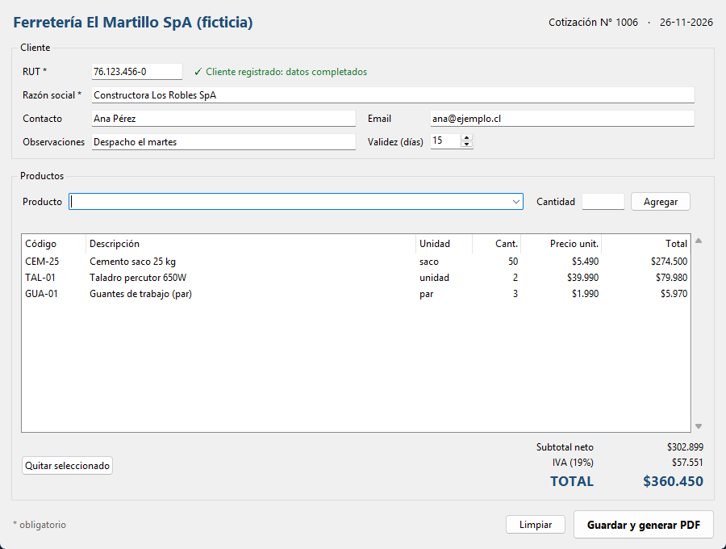
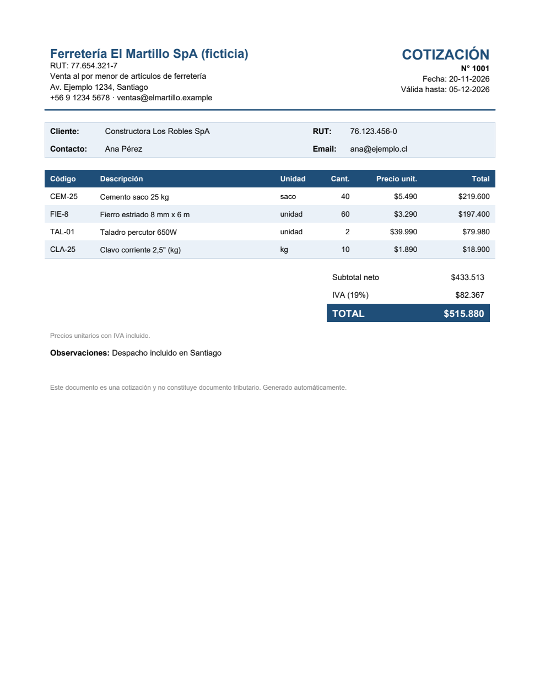

# Demo 1 · Generador de cotizaciones (Excel → PDF)

Crea cotizaciones en **PDF listas para enviar o imprimir** a partir de un catálogo de productos en Excel. Hay dos formas de usarlo:

| | Para quién | Cómo |
|---|---|---|
| **Formulario** | El vendedor, una cotización a la vez | Ventana donde elige cliente y productos; genera el PDF y la registra en el Excel |
| **Generación masiva** | Quien ya tiene muchas cotizaciones en Excel | Lee la planilla completa y genera todos los PDF, con un reporte de errores |

Pensado para pymes que hoy arman cada cotización a mano en Word o Excel copiando y pegando los mismos datos.





> Datos 100 % ficticios: "Ferretería El Martillo SpA" no existe.

---

## ¿Qué problema resuelve?

| Antes | Con el generador |
|---|---|
| Copiar datos del cliente y productos a una plantilla de Word, uno por uno | Llenar una fila por cotización en Excel y hacer doble clic |
| Calcular neto e IVA a mano, con errores de redondeo | Neto, IVA y total calculados siempre igual, y siempre cuadran |
| Errores de digitación (RUT mal escrito) que se descubren tarde | El programa los detecta y los informa todos juntos |

## Uso

### Formulario (recomendado para el día a día)

Doble clic en **`Formulario_cotizaciones.bat`** (o `python formulario.py`).

- **RUT validado mientras se escribe**: verde si es válido, rojo si no lo es.
- **Clientes recordados**: si el RUT ya cotizó antes, se completan nombre, contacto y email.
- **Productos desde el catálogo**: se busca escribiendo parte del código o del nombre (por ejemplo "taladro") y solo se ingresa la cantidad. El precio sale del catálogo, así que no hay errores de digitación.
- **Totales en vivo**: neto, IVA y total se actualizan al agregar o quitar productos.
- **Guardar y generar PDF**: crea el PDF en `salida/` y agrega la cotización a las hojas `Cotizaciones` y `Detalle` del Excel, con número correlativo automático.

La primera vez se crea `datos/cotizaciones.xlsx` como copia de la planilla de ejemplo. Ahí se guarda todo lo que se ingresa, y esa carpeta nunca se sube al repositorio.

### Generación masiva

Doble clic en **`Generar_cotizaciones.bat`**, o en la terminal:
```
python generar.py                          # usa datos/cotizaciones.xlsx
python generar.py ruta\a\mi_planilla.xlsx  # otra planilla
```

Salida con la planilla de ejemplo (que trae 2 errores a propósito):

```
  [OK] Cotización N° 1001 -> cotizacion_1001_Constructora_Los_Robles_SpA.pdf
  [OK] Cotización N° 1002 -> cotizacion_1002_Juan_Soto_particular.pdf
  [OK] Cotización N° 1004 -> cotizacion_1004_Gasfiteria_Rapida_SpA.pdf

Resumen: 3 PDF generados, 2 cotizaciones con problemas.

Revise en la planilla y vuelva a ejecutar:

  Cotización N° 1003 (Inmobiliaria Prueba Ltda.):
    - RUT del cliente inválido: 76.555.444-1

  Cotización N° 1005 (María González (particular)):
    - No tiene productos
```

## Estructura de la planilla

| Hoja | Una fila por... | Columnas |
|---|---|---|
| `Empresa` | dato del emisor | `campo`, `valor` (nombre, rut, giro, direccion, telefono, email) |
| `Cotizaciones` | cotización | `n_cotizacion`, `fecha`, `rut_cliente`, `razon_social`, `contacto`, `email`, `validez_dias`, `observaciones` |
| `Detalle` | producto cotizado | `n_cotizacion`, `codigo`, `descripcion`, `unidad`, `cantidad`, `precio_unitario_iva` |
| `Productos` | producto del catálogo | `codigo`, `descripcion`, `unidad`, `precio_unitario_iva` |

`Detalle` se une con `Cotizaciones` por `n_cotizacion`, igual que una *foreign key* en una base de datos. Los datos de la empresa están en su propia hoja para que el dueño los cambie **sin tocar código**.

## Decisiones de diseño

- **Precios con IVA en la planilla.** Es el valor que conoce el vendedor. Desde el total se calcula `neto = total / 1,19` y `IVA = total − neto`. Como el IVA se obtiene **restando**, neto + IVA siempre es igual al total, sin diferencias de $1 por redondeo.
- **Redondeo "de colegio"** (0,5 sube) con `Decimal`, porque el `round()` de Python usa redondeo bancario (`round(2.5) == 2`).
- **Validar y reportar, sin detenerse.** Una cotización con errores no detiene las demás, y cada cotización lista **todos** sus problemas a la vez.
- **RUT flexible.** Acepta `76.123.456-0`, `76123456-0` o `k` minúscula: se normaliza antes de aplicar el módulo 11.
- **Un módulo por responsabilidad.** Solo `lectura.py` y `escritura.py` saben que los datos están en Excel; cambiar a Google Sheets significaría tocar solo esos archivos. El formulario y la generación masiva usan las **mismas** validaciones, cálculos y diseño de PDF.
- **Escribir con openpyxl, no con pandas.** Así el Excel conserva sus colores, anchos de columna y formatos de fecha y pesos. Las columnas se buscan por nombre, no por posición.
- **Primero el PDF, después el Excel.** Si la planilla está abierta y no se puede guardar, basta con cerrarla y volver a presionar Guardar, sin duplicar registros.

## Estructura del código

```
demo1-generador-documentos/
├── formulario.py              ← ventana para crear cotizaciones (tkinter)
├── generar.py                 ← generación masiva y reporte de errores
├── Formulario_cotizaciones.bat
├── Generar_cotizaciones.bat
├── generador/
│   ├── config.py              ← rutas compartidas
│   ├── lectura.py             ← Excel → diccionarios de Python
│   ├── escritura.py           ← agregar cotizaciones al Excel
│   ├── validaciones.py        ← RUT (módulo 11), campos obligatorios, montos
│   ├── calculos.py            ← neto, IVA, total, formato $1.234.567
│   └── pdf.py                 ← diseño del documento (reportlab)
├── tests/                     ← 50 tests con pytest
├── datos_ejemplo/             ← planilla ficticia (no se modifica)
├── datos/                     ← planilla de trabajo (no se sube al repo)
└── salida/                    ← PDF generados (no se suben al repo)
```

## Instalación (desarrollo)

Requiere Python 3.12 o superior.

```
python -m venv .venv
.venv\Scripts\activate
pip install -r requirements.txt
pytest                       # ejecutar los tests
```

## Próximos pasos

- [x] Formulario para el vendedor (tkinter)
- [ ] Logo de la empresa en el encabezado
- [ ] Buscar y reimprimir cotizaciones anteriores desde el formulario
- [ ] Empaquetar como `.exe` con PyInstaller (sin instalar Python)
- [ ] Soporte para Google Sheets
- [ ] Otros documentos: contratos y comprobantes de entrega

## Tecnologías

Python · tkinter · pandas · openpyxl · reportlab · pytest
